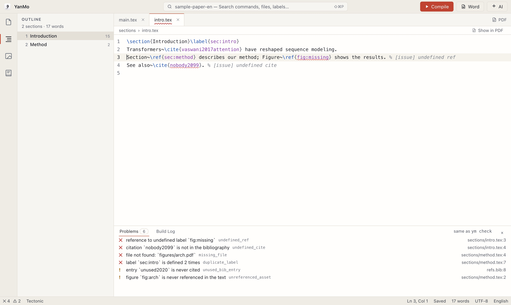

<p align="center"></p>

<p align="center"><b>English</b> · <a href="README.zh-CN.md">简体中文</a></p>

# YanMo

An open-source, local-first desktop app for writing and compiling LaTeX papers, with AI built in. Its Chinese name, 研墨 (yán mò), means grinding ink before writing.

- **Write and build in one place**: CodeMirror editor, built-in Tectonic compiler (no TeX install needed), PDF preview and two-way SyncTeX
- **Structure at a glance**: an outline you can reorder by dragging, a figures and tables view, a searchable bibliography with Zotero search and reference checks, and reference problems caught as you write
- **AI you stay in charge of**: bring your own key (Claude, any OpenAI-compatible API or a local Ollama); every change is shown as a diff and applied only after you accept it
- **Agent-friendly**: the app, the `ym` command line and the MCP server share one command registry, so Claude Code and other agents can read, check and compile your paper



> Status: preview v0.3. Website: [yanmo.ink](https://yanmo.ink/en/). Changes: [CHANGELOG](CHANGELOG.md). Design notes ([roadmap](docs/MVP.md), [architecture](docs/ARCHITECTURE.md)) are in Chinese for now.

## Install

Download the installer for your system from [Releases](https://github.com/ismethr/YanMo/releases) or [yanmo.ink](https://yanmo.ink/en/) (macOS .dmg, Windows .exe / .msi, Linux .AppImage / .deb / .rpm). From v0.2 on, YanMo tells you when an update is available and installs it in one click.

The installers include the Tectonic engine, so there is no separate TeX distribution to install. Exporting to Word needs [Pandoc](https://pandoc.org/installing.html).

If macOS says the developer cannot be verified on first launch, right-click YanMo in Finder and choose Open, or run `xattr -cr /Applications/YanMo.app`.

The interface is available in English and Chinese; switch from the status bar in the bottom-right corner.

## Connect Claude Code and other agents

The app ships with the `ym` command line. `ym mcp` is an MCP server that lets agents read the outline, check references, compile and read errors, import references and reorder sections. In the app, press ⇧⌘P and run "Connect Claude Code or Other Agents" to copy the setup command, which looks like:

```bash
claude mcp add yanmo -- /Applications/YanMo.app/Contents/MacOS/ym mcp -C /path/to/paper
```

The full tool list is in [docs/mcp.md](docs/mcp.md) (in Chinese).

## Development

Requirements: Rust stable, Node 22, pnpm (version in `packageManager` of `apps/desktop/ui/package.json`); on Linux also webkit2gtk-4.1.

```bash
pnpm --dir apps/desktop/ui install

# Desktop app (Tauri; starts the frontend dev server too). Run sh scripts/fetch-tectonic.sh once first
pnpm --dir apps/desktop/ui tauri dev

# UI only: browser preview with sample data, no Rust build needed (add ?lang=en for the English UI and sample)
pnpm --dir apps/desktop/ui dev

# Tests and the command line
cargo test --workspace
cargo run -p ym-cli -- -C examples/sample-paper-en check
cargo run -p ym-cli -- exec                      # list every command in the registry
```

Packaging and releases: [docs/release.md](docs/release.md) (in Chinese).

After changing what a Rust command returns, run `pnpm --dir apps/desktop/ui fixtures` to regenerate the preview data.

## License

Licensed under either of [MIT](LICENSE-MIT) or [Apache-2.0](LICENSE-APACHE), at your option.
